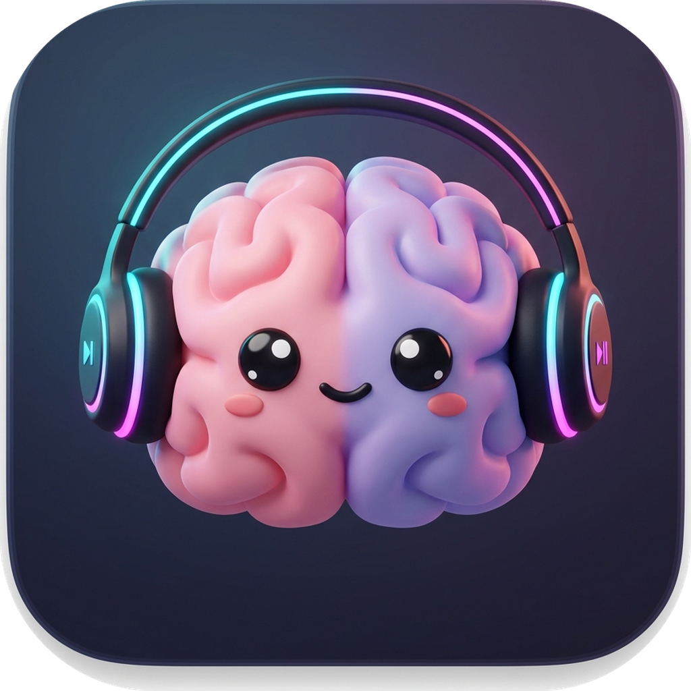
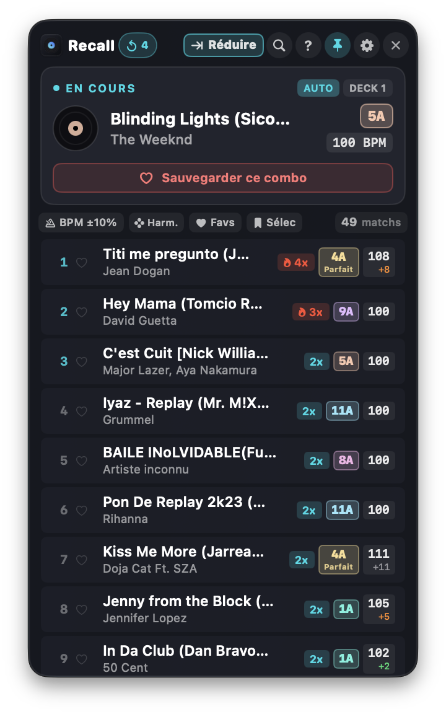
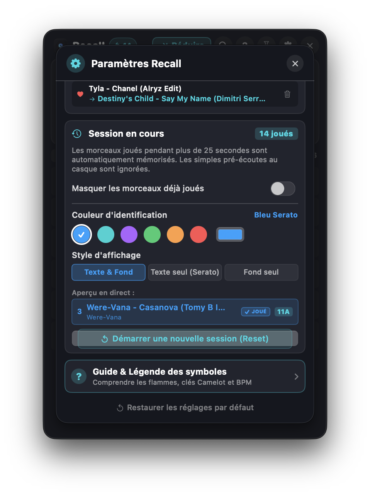
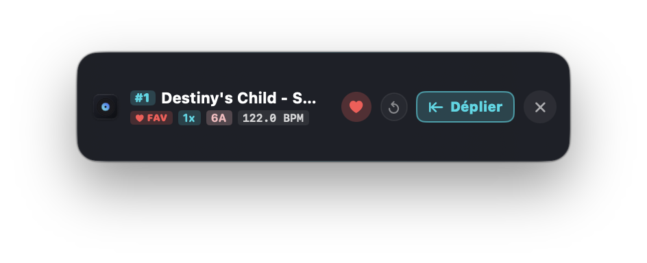

<p align="center">
  
</p>

<h1 align="center">Recall</h1>

<p align="center">
  <strong>Compagnon indépendant d'enchaînements musicaux compatible avec Serato DJ Pro &amp; Rekordbox</strong><br>
  <em>Suggère en temps réel vos meilleures transitions, basées exclusivement sur vos routines et votre historique réel de mix.</em>
</p>

<p align="center">
  <a href="https://github.com/REVRmusic/recall/releases"></a>
  
  
  
  
  
  <a href="LICENSE"></a>
  <a href="PRIVACY.md"></a>
</p>

---

## 📸 Aperçu de l'Interface

<p align="center">
  
  
</p>

<p align="center">
  <em>Mode compact discret repliable toujours visible au-dessus de Serato DJ Pro :</em><br>
  
</p>

---

## ⚡️ Pourquoi Recall ?

Pendant un set DJ, retrouver rapidement le morceau idéal qui enchaîne parfaitement avec ce qui tourne sur la platine active est crucial. 

Contrairement aux solutions génériques qui se basent sur des algorithmes opaques ou de simples classements de streaming, **Recall analyse directement vos propres sessions passées dans Serato DJ Pro et Rekordbox** :
- **Vos vraies routines** : Si vous avez enchaîné un morceau 12 fois l'an dernier et que le dancefloor a réagi, Recall s'en souvient et vous le propose en tête de liste (`🔥 12x`).
- **Harmonie instantanée** : Respect fidèle des couleurs de la **Roue de Camelot** et filtrage automatique des clés compatibles.
- **Glisser-Déposer direct (`Drag & Drop`)** : Attrapez la suggestion et déposez-la directement sur vos platines Serato ou Rekordbox.
- **Compatibilité Universelle** : Détection automatique intelligente de votre logiciel DJ actif (Serato DJ Pro ou Pioneer DJ Rekordbox) avec zéro surcharge processeur.

---

## 📥 Téléchargement & Installation

### 🍏 Pour macOS

#### Option 1 : Téléchargement Direct (Recommandé)
1. Rendez-vous sur la page des **[Releases GitHub](https://github.com/REVRmusic/recall/releases)**.
2. Téléchargez **`Recall.dmg`**.
3. Ouvrez le fichier `.dmg` et glissez **Recall** dans votre dossier **Applications**.
4. Lancez **Serato DJ Pro**, puis ouvrez **Recall** : la détection est automatique et immédiate !

> **Note macOS (Gatekeeper)** : Au premier lancement, si macOS affiche un avertissement de sécurité, faites un clic droit (ou Contrôle + clic) sur **Recall.app** dans `/Applications` puis cliquez sur **Ouvrir**.

#### Option 2 : Installation en 1 ligne dans le Terminal
```bash
/bin/bash -c "$(curl -fsSL https://raw.githubusercontent.com/REVRmusic/recall/main/install.sh)"
```

#### Option 3 : Compilation depuis les Sources (macOS)
```bash
git clone https://github.com/REVRmusic/recall.git
cd recall
chmod +x build.sh && ./build.sh --dmg
```

---

### 🪟 Pour Windows (10 & 11)

#### Option 1 : Téléchargement Direct (Recommandé)
1. Rendez-vous sur la page des **[Releases GitHub](https://github.com/REVRmusic/recall/releases)**.
2. Téléchargez **`Recall-Windows-x64.zip`** ou l'exécutable autonome **`Recall.exe`**.
3. Dézippez l'archive dans le dossier de votre choix (ex: `C:\Program Files\Recall` ou sur votre Bureau).
4. Lancez **Serato DJ Pro**, puis double-cliquez sur **`Recall.exe`** : la détection de votre base `%LOCALAPPDATA%\Serato\Library\master.sqlite` est instantanée !

#### Option 2 : Compilation depuis les Sources (Windows)
Prérequis : PC sous Windows 10/11 avec le SDK [.NET 8](https://dotnet.microsoft.com/download/dotnet/8.0) installé.
```cmd
git clone https://github.com/REVRmusic/recall.git
cd recall\Windows
build-windows.bat
```
L'exécutable autonome optimisé est généré directement dans `Windows\build-win\Recall.exe`.

---

## 🌟 Fonctionnalités Détaillées

### 1. ⏱️ Détection Intelligente Serato DJ Pro & Rekordbox
- **Serato DJ Pro** : Détection sub-milliseconde des platines actives (Deck 1 / Deck 2) via accès direct sécurisé en lecture seule (`PRAGMA query_only = ON`) au fichier SQLite WAL.
- **Pioneer DJ Rekordbox** : Lecture et analyse ultra-rapide de votre collection et de vos historiques de playlists (format standard XML Rekordbox). Détecte des dizaines de milliers d'enchaînements passés en quelques fractions de seconde.
- **Détection Automatique ou Choix Manuel** : Bascule instantanément sur le logiciel DJ actif (Serato ou Rekordbox) sans surcharge CPU.
- Mode **MANUEL** avec recherche instantanée dans toute votre bibliothèque pour préparer une transition à froid.

### 2. 📈 Algorithme de Routines Historiques (30 à 730 jours)
- Priorise strictement les titres que vous avez **réellement enchaînés** dans vos sets passés.
- Exclusion des lectures isolées ou des pré-écoutes rapides.
- Décompte visuel dynamique : `🔥 15x`, `🔥 6x`, `2x`.

### 3. 🎯 Glisser-Déposer Natif (Drag & Drop)
- Glissez n'importe quelle ligne de suggestion directement sur vos platines Serato DJ Pro ou Rekordbox.
- Intégration double flux macOS (`NSFilenamesPboardType` et `public.file-url`) et Windows (`DataFormats.FileDrop`) garantissant une réactivité instantanée.

### 4. 🎼 Clés Camelot Officielles & Filtre BPM Intelligent
- Couleurs authentiques de la roue Camelot pour les 24 tonalités (Mineures `A` et Majeures `B`).
- Filtre rapide **Harmonie** (clés compatibles : Identique, Parfaite ±1, Relative, Boost +2).
- Filtre **BPM ±10%** prenant automatiquement en compte les relations half-time et double-time (ex: 75 BPM compatible avec 150 BPM).

### 5. 🔵 Marquage des Morceaux Déjà Joués
- Identification visuelle instantanée des morceaux déjà joués au cours de votre set pour éviter les doublons accidentels.
- Rendu fidèle : surbrillance en **Bleu officiel (`#0FA2FF`)**.
- **Palette de couleurs personnalisable** dans les paramètres (Bleu officiel, Cyan Électrique, Violet, Émeraude, Orange, Rose, ou sélecteur libre).
- **3 styles d'affichage** : Texte & Fond, Texte seul, ou Fond seul.
- Bouton de remise à zéro rapide de session en un clic.

### 6. ⭐ Combinaisons Favorites & Filtre "Favs"
- Enregistrement immédiat d'une alchimie parfaite entre deux morceaux via le bouton **Favori** avec modal de confirmation rapide.
- Filtre rapide **Favoris** pour isoler vos enchaînements fétiches en situation de mix intense.

### 7. 🪟 Interface Flottante Compacte (`Always-on-top`)
- Se positionne discrètement au-dessus de Serato sans jamais gêner les platines ou les crates.
- Verre dépoli translucide moderne (*frosted glass vibrancy* / `.ultraThinMaterial`).
- Bouton de réduction en **Bandeau Compact** affichant le Top Match en cours d'un simple coup d'œil.

---

## 🔒 Confidentialité & Sécurité Absolue

- **100% Hors-ligne** : Aucune donnée ne quitte votre machine. Zéro serveur, zéro télémétrie, zéro traceur.
- **Accès en Lecture Seule** : Recall ne modifie jamais votre base Serato, vos fichiers audio ou vos tags ID3.
- **Conception Native Double-Plateforme** :
  - **macOS** : Développé exclusivement en **Swift pur** avec les frameworks natifs d'Apple (SwiftUI, AppKit, SQLite3).
  - **Windows** : Développé en **C# / .NET 8 WPF** haute performance avec `Microsoft.Data.Sqlite` et support autonome sans dépendance.

---

## 🛠️ Structure du Projet

```
Recall/
├── Package.swift               # Configuration Swift Package Manager (macOS)
├── build.sh                    # Script de compilation Release macOS (Recall.app & Recall.dmg)
├── install.sh                  # Script d'installation automatique macOS en une ligne
├── run.sh                      # Lanceur rapide en mode développement macOS
├── LICENSE                     # Licence MIT
├── PRIVACY.md                  # Politique de confidentialité 100% hors-ligne
├── Resources/                  # Icônes haute définition et captures d'écran
├── Sources/                    # Code source natif macOS (SwiftUI / AppKit)
│   └── Recall/
│       ├── App/                # Cycle de vie Cocoa, NSApplication et FloatingWindowController
│       ├── Models/             # Modèles de données (Track, CamelotKey, UserSettings)
│       ├── Services/           # SQLite Serato (WAL), Rekordbox (XML), surveillance, Drag & Drop
│       ├── Views/              # Vues SwiftUI modernes (Main, NowPlaying, Suggestions, Settings, Bandeau)
│       └── Utils/              # Extensions graphiques et configurateurs de défilement
└── Windows/                    # Version native Windows (10 & 11 - C# / .NET 8 WPF)
    ├── Recall.sln              # Solution Visual Studio
    ├── build-windows.bat       # Script de compilation 1-clic (.exe autonome)
    ├── run-windows.bat         # Lanceur rapide Windows
    └── Recall/
        ├── Recall.csproj       # Projet .NET 8 WPF x64
        ├── MainWindow.xaml     # Interface flottante sombre & bandeau compact
        ├── SettingsWindow.xaml # Modale de configuration (Serato, Rekordbox, filtres)
        ├── Models/             # Modèles Track, CamelotKey, UserSettings
        ├── Services/           # SeratoDatabaseService, RekordboxService, Monitor, Combos
        └── Resources/          # Icône Windows AppIcon.ico
```

---

## ⚖️ Mentions Légales & Marques Déposées

- **Serato Limited** : *Serato*, *Serato DJ*, *Serato DJ Pro*, *Serato DJ Lite* et leurs logos respectifs sont des marques déposées appartenant à **Serato Limited**.
- **AlphaTheta Corporation** : *Rekordbox*, *Pioneer DJ* et leurs logos respectifs sont des marques déposées appartenant à **AlphaTheta Corporation**.
- **Clause de non-affiliation** : Recall est un logiciel indépendant développé par **REVR** pour la communauté DJ. Recall n'est en aucun cas affilié, sponsorisé, associé, validé ou certifié par Serato Limited ou AlphaTheta Corporation. L'utilisation des noms de marque dans cette documentation et dans l'application est faite à titre purement descriptif afin d'indiquer la compatibilité technique du logiciel (*Nominative Fair Use*).
- **Protection de la vie privée** : Pour consulter notre engagement de confidentialité 100 % hors-ligne, reportez-vous au fichier [PRIVACY.md](PRIVACY.md).

---

## 📄 Licence

Ce projet est distribué sous licence libre **MIT**. Consultez le fichier [LICENSE](LICENSE) pour plus de détails.

---

<p align="center">
  Développé avec passion pour la communauté DJ par <strong>REVR</strong>.
</p>
